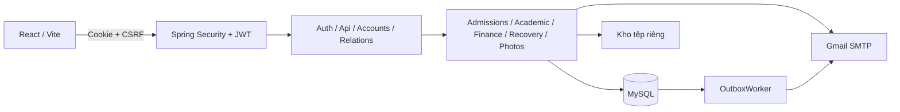
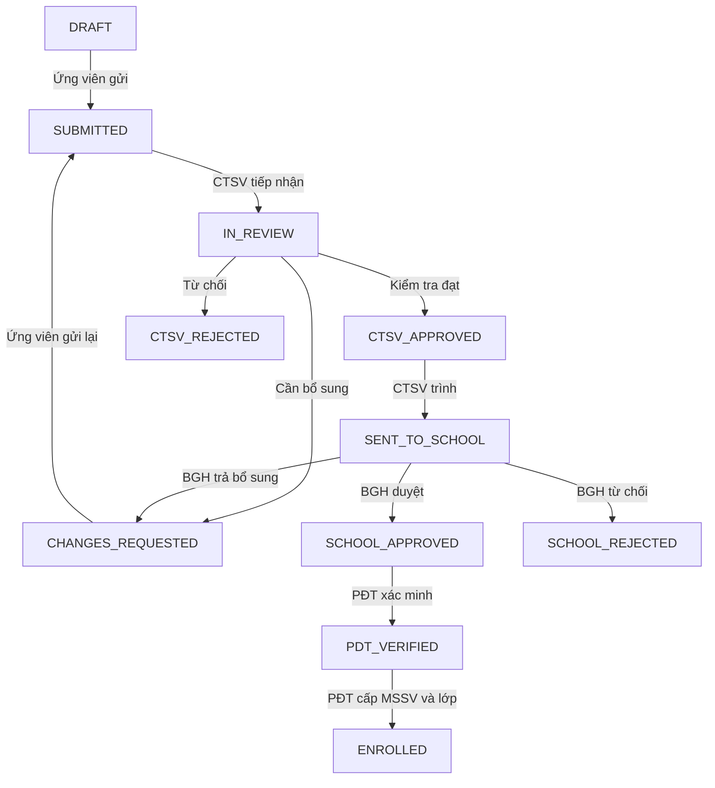

# Backend V6 — kiến trúc, nghiệp vụ và cách chạy

Cập nhật: 10/11/2026. Tài liệu này mô tả mã đang có, không coi việc có endpoint là bằng chứng mọi tình huống đã được kiểm thử. Danh sách đường dẫn thực tế nằm trong [API_BACKEND_V6.md](API_BACKEND_V6.md).

## 1. Dữ liệu và các lớp xử lý

Mã nguồn đã tách khỏi package `v6` thành `bootstrap`, `config`, `controller`, `exception`, `repository`, `security` và `service` theo nghiệp vụ. Xem [cây thư mục backend](../backend/README.md#cấu-trúc-mã-nguồn). Việc tổ chức package không đổi URL API hoặc schema/seed.

Backend dùng Java 21, Spring Boot, Spring Security và JDBC truy vấn MySQL. Frontend gọi `/api` qua Vite; browser không kết nối trực tiếp database. Hibernate không tạo hoặc sửa bảng khi khởi động.



| Lớp | Nhiệm vụ |
|---|---|
| `SecurityConfig` | Xác thực BCrypt, cookie phiên, CSRF, các URL công khai và từ chối truy cập API chưa đăng nhập |
| `LoginTokens`, `LoginTokenFilter` | Ký/kiểm tra JWT HS512, issuer, audience, thời hạn và ràng buộc với phiên server |
| `Actor` | Đọc tài khoản đang dùng, enabled, vai trò và ID sinh viên/giảng viên từ database; ghi audit |
| `AuthController` | Đăng nhập, khởi tạo hồ sơ ứng viên, quên/đặt lại mật khẩu |
| `AccountsController`, `BootstrapPrincipal` | BGH tạo nhân sự, đổi mật khẩu, tạo tài khoản quản trị đầu tiên |
| `Resources` | Metadata và CRUD theo danh sách trường được phép; tìm kiếm, phân trang, lọc phạm vi dữ liệu |
| `Admissions` | Trạng thái hồ sơ, kiểm tra giấy tờ, cấp MSSV/phân lớp theo quyết định duyệt |
| `Documents`, `IdentityRecords` | Tệp riêng tư, định danh mã hóa, học bạ và điểm THPT |
| `Academic` | Đăng ký/hủy học phần, lịch nhiều buổi, nhập và duyệt điểm |
| `FinanceService` | Hóa đơn snapshot, thu, điều chỉnh, bàn giao và báo cáo CTSV |
| `RelationsController` | Học phần trong chương trình, thông báo, người nhận và chi tiết yêu cầu |
| `StudentPhotos` | Quyền truy cập ảnh sinh viên, xác thực và mã hóa lại ảnh JPEG/PNG |
| `PasswordRecovery`, `MailConfiguration` | Token khôi phục một lần và kết nối Gmail SMTP |
| `OutboxWorker` | Nhận email hàng đợi, gửi, ghi lần thử và giới hạn gửi lại |
| `Db`, `ApiErrors` | Tham số hóa truy vấn, thực thi SQL và chuẩn hóa lỗi API |

Ba file SQL gốc và các bản ghi sinh viên cũ được giữ lại. Database đang dùng là `sms_v6_original`. Sau migration 05–10, schema ứng dụng có 53 bảng, gồm bảo mật/ảnh, lịch thi và các danh mục phòng/loại thi. Chỉ bổ sung ô trống của hồ sơ demo và bản ghi demo còn thiếu, không sửa file seed gốc. Xem [chuẩn hóa SQL và nghiệm thu](CHUAN_HOA_SQL_2026_11_12.md) cùng [luồng lịch thi và giao diện sinh viên](KHOI_PHUC_GIAO_DIEN_SINH_VIEN_2026_11_12.md).

## 2. Sáu vai trò

| Vai trò | Công việc chính |
|---|---|
| APPLICANT | Mở, sửa, tải giấy tờ và gửi hồ sơ của mình |
| CTSV | Kiểm tra hồ sơ; thu học phí; quỹ; lập điều chỉnh, bàn giao, báo cáo; tiếp nhận yêu cầu |
| PRINCIPAL | BGH duyệt hồ sơ/điểm/điều chỉnh/bàn giao/báo cáo; quản lý nhân sự, quyền và email trường |
| TRAINING_OFFICE | PĐT xác minh sau duyệt, cấp MSSV/phân lớp, quản lý đào tạo, kiểm tra/công bố điểm |
| LECTURER | Xem lớp được phân công, nhập và gửi bảng điểm |
| STUDENT | Xem hồ sơ, lịch/điểm được công bố, đăng ký học phần, công nợ và gửi yêu cầu của mình |

Không tạo vai trò SYS_ADMIN. Tài khoản `principal` được tạo riêng bằng bootstrap mang vai trò PRINCIPAL. Một tài khoản có thể có nhiều vai trò; thay vai trò hiển thị trên FE không tự cấp quyền trên server. Các thao tác vẫn kiểm tra người sở hữu và quyền cụ thể.

## 3. Đăng nhập và bảo mật

1. FE lấy `GET /api/auth/csrf`, giữ cookie do server cấp.
2. FE gửi username/email, password và CSRF tới `/auth/login`.
3. Spring kiểm tra BCrypt và trạng thái hoạt động; đổi ID phiên chống session fixation.
4. Server ký JWT HS512 bằng khóa 64 byte ngẫu nhiên. Token chứa định danh, thời điểm, issuer, audience, ID phiên và dấu vân tay mật khẩu; không chứa mật khẩu, CCCD hoặc toàn bộ hồ sơ.
5. Browser nhận `SMS_ACCESS` HttpOnly, SameSite=Lax, Path=/api, hạn 30 phút. JWT được ký để chống sửa, **không phải nội dung được mã hóa**. Không lưu token trong localStorage.
6. Mỗi yêu cầu kiểm tra JWT cùng phiên server; quyền và trạng thái tài khoản lấy lại từ database. JWT bị sửa, thiếu cookie trong phiên đăng nhập, hết hạn hoặc không khớp phiên đều bị từ chối.
7. Đăng xuất hủy phiên và cookie. Đổi/khôi phục mật khẩu thay dấu vân tay, làm JWT cũ không còn hợp lệ ở yêu cầu tiếp theo.

Mật khẩu lưu bằng BCrypt. CCCD/hộ chiếu dùng AES-GCM, số đầy đủ không trả về danh sách; chỉ trả bốn ký tự cuối. Khóa JWT và khóa mã hóa định danh là hai khóa khác nhau, lưu trong `backend/.env.local`, bị Git bỏ qua. Cần giữ ổn định khóa định danh để đọc dữ liệu đã mã hóa.

## 4. Hồ sơ nhập học



Không có đăng ký tài khoản độc lập. `/public/admissions` kiểm tra đợt đang mở và ngành tồn tại, rồi tạo APPLICANT và hồ sơ DRAFT trong cùng transaction. Thất bại không để lại tài khoản mồ côi. Một người/một đợt tuân theo UNIQUE của SQL.

Ứng viên chỉ sửa DRAFT/CHANGES_REQUESTED thuộc mình. Giấy tờ yêu cầu lấy từ cấu hình của đợt; không dùng danh sách tệp cố định trong FE. Mỗi lần nộp có revision mới. Chỉ CTSV xác minh phiên bản mới nhất khi IN_REVIEW. Gửi hồ sơ cần đủ tệp bắt buộc; kiểm tra đạt cần các tệp đó VERIFIED.

CCCD và học bạ nhập tại chi tiết hồ sơ. Backend lưu trường định danh riêng, học bạ riêng và điểm môn lớp 10/11/12 riêng. Một số trường thông tin không bắt buộc theo schema nên có thể rỗng; không tự bịa dữ liệu để lấp chỗ trống.

Sau BGH duyệt, PĐT mới được cấp MSSV. Backend kiểm tra lớp đúng ngành/khóa của đợt và có sự kiện SCHOOL_APPROVE. Cùng transaction tạo sinh viên, gán STUDENT, chuyển thông tin cá nhân/người giám hộ và đặt trước email trường RESERVED. BGH duyệt không tự tạo sinh viên hoặc cấp hộp thư thật. Mọi chuyển trạng thái ghi `admission_review_events`, audit và email hàng đợi.

## 5. Hồ sơ sinh viên và ảnh

Danh sách/hồ sơ hiển thị MSSV, họ tên, ngày sinh, giới tính, nơi sinh, quê quán, quốc tịch, lớp/ngành, điện thoại, email, địa chỉ, người giám hộ, ngày nhập học và trạng thái.

Sinh viên chỉ truy cập ảnh của mình; nhân sự xem theo phạm vi tài khoản được cấp. Sinh viên, CTSV, PĐT hoặc BGH có quyền phù hợp có thể tải ảnh. Giảng viên không được đổi ảnh.

Tải JPEG/PNG tối đa 5 MB, ít nhất 32×32 và tối đa 16 triệu điểm ảnh. Server đọc định dạng thật, kiểm tra kích thước trước giải mã, chuyển thành JPEG sạch để loại metadata/nội dung thừa, lưu UUID trong kho riêng. Database chỉ lưu metadata. Giao dịch lỗi sẽ dọn ảnh mới; thay thành công sẽ dọn ảnh cũ. Không có ảnh thật thì FE hiển thị chữ viết tắt, không gán ảnh một người khác cho sinh viên.

## 6. Danh mục, lịch học và đăng ký

PĐT quản lý khoa → ngành; khóa → lớp hành chính; năm học → học kỳ; học phần → chương trình → học phần trong chương trình; giảng viên → lớp học phần → nhiều buổi học. BGH quản lý đợt nhập học; CTSV quản lý đơn giá/quỹ. Tên bảng SQL và ID/FK được giữ xuyên suốt API.

Tạo lớp học phần mới đồng thời tạo bảng điểm DRAFT. Khi thêm lịch, kiểm tra thứ 1–7, giờ bắt đầu trước giờ kết thúc, trùng phòng và giảng viên trong kỳ. Chủ nhật được hỗ trợ.

Đăng ký học phần khóa dòng sinh viên/lớp để kiểm tra:

- Sinh viên STUDYING, kỳ OPEN và nằm trong registration_from/to; lớp đang mở.
- Chưa đăng ký cùng học phần trong kỳ, lớp còn sĩ số.
- Không trùng bất kỳ buổi học nào đã đăng ký.
- Học phần thuộc chương trình của ngành/khóa nếu đã có chương trình.
- Chưa phát hành hóa đơn kỳ đó; nếu đã phát hành phải dùng yêu cầu/điều chỉnh nghiệp vụ.

Hủy chỉ áp dụng REGISTERED, đúng cửa sổ thời gian và bảng điểm chưa vào quy trình xét duyệt. Giữ bản ghi CANCELLED thay vì xóa lịch sử.

## 7. Điểm và phê duyệt

GV chỉ nhập điểm cho enrollment thuộc lớp được phân công; mỗi điểm 0–10, chưa đủ điểm có thể lưu nháp. Không sửa bảng đã gửi trừ khi RETURNED.

`DRAFT/RETURNED → SUBMITTED (GV) → VERIFIED (PĐT) → APPROVED (BGH) → PUBLISHED (PĐT)`.

Gửi cần đủ ba điểm cho mọi đăng ký chưa hủy. PĐT/BGH trả lại cần lý do. Mỗi hành động ghi `grade_reviews`, tăng phiên bản. Điểm liên kết bằng enrollment_id và tổng điểm dùng tỷ trọng của từng lớp. Sinh viên chỉ thấy điểm khi bảng PUBLISHED.

## 8. Học phí, điều chỉnh, quỹ và báo cáo

**Phát hành hóa đơn:** CTSV chọn sinh viên/kỳ. Backend khóa dòng, chặn hóa đơn trùng kỳ, đọc đơn giá kỳ và đăng ký hợp lệ, chụp snapshot tín chỉ/đơn giá vào invoice_items. Thay đơn giá/học phần sau này không sửa giá trị hóa đơn đã phát hành.

**Thu tiền:** CTSV chọn hóa đơn/quỹ đang hoạt động, nhập số tiền và chứng từ duy nhất. Backend khóa hóa đơn/quỹ, đọc công nợ từ VIEW, từ chối thu vượt còn nợ. Sinh viên chỉ xem khoản thu, không tự xác nhận đã nộp. Không có cổng thanh toán trực tuyến trong backend này.

**Điều chỉnh:** CTSV đề nghị DEBIT/CREDIT và lý do → REQUESTED. BGH APPROVED/REJECTED. Giảm trừ không vượt nợ còn lại; hoàn tiền cần quy trình riêng, chưa triển khai tự động.

**Bàn giao:** CTSV lập SUBMITTED với danh sách payment_id/allocated_amount. Mỗi chứng từ có thể phân bổ một phần qua nhiều đợt; tổng SUBMITTED/CONFIRMED không vượt khoản thu. Backend kiểm tra cùng quỹ/kỳ, không lặp chứng từ. BGH CONFIRMED/REJECTED; người lập không tự xác nhận, từ chối phải có lý do.

**Báo cáo:** CTSV lập/gửi sau khi học kỳ kết thúc. Mỗi kỳ một báo cáo; DRAFT/RETURNED có thể gửi lại. BGH APPROVED/RETURNED, người lập không tự duyệt. Lịch sử lưu trong ctsv_semester_report_reviews. Tổng hợp lấy VIEW tài chính hiện tại; chưa xuất PDF, ký số hoặc đóng băng báo cáo đã ký.

## 9. Yêu cầu, thông báo và audit

Sinh viên gửi loại yêu cầu được SQL hỗ trợ, nội dung và tệp đính kèm. CTSV tiếp nhận, chuyển người xử lý thuộc CTSV/PĐT, yêu cầu thêm thông tin, xử lý/từ chối/mở lại hoặc trình BGH. PĐT chỉ thấy yêu cầu giao cho mình. Các hành động được ghi sự kiện; tệp tải qua API có quyền. BGH có phản hồi cấp trường.

CTSV/PĐT/BGH tạo thông báo, gửi theo mã vai trò tới tài khoản hoạt động. Gửi lại không nhân đôi người nhận. Sinh viên/giảng viên/ứng viên chỉ xem thông báo đã gửi cho mình; đánh dấu đọc một lần. Nhân sự xem danh sách người nhận/read_at.

Audit ghi đăng nhập, thay tài khoản/quyền, chuyển trạng thái, điểm, giao dịch và truy cập tệp nhạy cảm. Không ghi password, khóa hoặc token khôi phục vào audit. Audit trong database chưa có cơ chế chống quản trị DB chỉnh sửa độc lập.

## 10. Email trường, Gmail và quên mật khẩu

Email trường: `RESERVED → PROVISIONING → ACTIVE/FAILED/DISABLED`. Chỉ BGH cấu hình/xác nhận; ACTIVE yêu cầu xác nhận hộp thư đã được cấp thật và có thể truy cập. API này **không tự tạo tài khoản Google Workspace**; quản trị phải cấp hộp thư ở Google trước.

Quên mật khẩu:

1. Sinh viên chọn Quên mật khẩu và nhập email trường.
2. Backend chỉ tạo token khi có STUDENT hoạt động và mailbox ACTIVE trùng email đó; không dùng email cá nhân thay thế.
3. Token 32 byte ngẫu nhiên, database chỉ giữ SHA-256; hết hạn sau 20 phút, yêu cầu mới vô hiệu link cũ.
4. Gmail SMTP gửi link `/#reset-password/<token>`; fragment tránh đưa token vào URL request/log server. Không gửi lại mật khẩu cũ.
5. Sinh viên nhập/xác nhận mật khẩu mới từ 12 ký tự. Backend kiểm tra token chưa dùng/chưa hết hạn, băm BCrypt và tiêu thụ các token còn lại.
6. JWT cũ bị vô hiệu sau đổi mật khẩu; sinh viên đăng nhập lại. Không tự đăng nhập bằng link reset.

API trả thông báo chung để không công khai tài khoản có tồn tại không. Nếu SMTP chưa cấu hình, trả 503 rõ ràng. Nếu gửi lỗi, đánh dấu token FAILED/không dùng được; không ghi chi tiết có thể chứa bí mật vào log.

Với email nghiệp vụ thông thường, OutboxWorker mặc định tắt. Khi bật, worker nhận từng bản ghi bằng transaction/khóa dòng, chuyển SENDING, gửi rồi ghi SENT/FAILED và email_delivery_attempts. Tự thử tối đa ba lần; CTSV/BGH có thể yêu cầu gửi lại bản FAILED, giới hạn tổng mười lần. Nếu tiến trình chết lúc SENDING, cần đối chiếu nhà cung cấp rồi xử lý thủ công để tránh gửi trùng; chưa có cơ chế phục hồi/idempotency với nhà cung cấp.

Gmail dùng `smtp.gmail.com:587` và STARTTLS theo [tài liệu Google](https://developers.google.com/workspace/gmail/imap/imap-smtp). Mật khẩu ứng dụng yêu cầu bật xác minh hai bước và chính sách tài khoản cho phép; xem [hướng dẫn Google](https://support.google.com/accounts/answer/185833?hl=en). Nếu Workspace chặn mật khẩu ứng dụng, quản trị cần cấu hình SMTP relay/OAuth riêng; bản này chưa có OAuth Gmail.

## 11. Chạy trên máy hiện tại

FE: `http://127.0.0.1:5173`. API: `http://127.0.0.1:8081/api`. MySQL: `sms_v6_original`.

Thông tin đăng nhập BGH cục bộ nằm tại `backend/.local/admin-credentials.txt`, không commit và không dùng mật khẩu chung trong seed. Đăng nhập lần đầu rồi đổi mật khẩu. Bootstrap chỉ tạo tài khoản mới; sau khi thành công đặt `sms.bootstrap.enabled=false` trong `.env.local`.

Chạy backend tại thư mục `backend`:

```powershell
mvn.cmd "-Dmaven.repo.local=$env:USERPROFILE/.m2/repository" spring-boot:run
```

Chạy frontend tại `frontend`:

```powershell
npm.cmd run dev -- --host 127.0.0.1
```

Cấu hình Gmail từ thư mục gốc; mật khẩu nhập trong hộp thoại trên máy:

```powershell
powershell -ExecutionPolicy Bypass -File .\backend\Configure-Gmail.ps1
```

Khởi động lại backend sau cấu hình. Không tự bật SMS_OUTBOX_ENABLED trên seed chứa địa chỉ giả. Trước khi dùng link khôi phục ngoài máy, đặt SMS_PUBLIC_URL thành URL trường thực tế, dùng HTTPS và SESSION_SECURE=true.

## 12. Kiểm tra và giới hạn

Kết quả lượt cuối: 21 kiểm thử backend đạt (1 kiểm thử khởi động và 20 kiểm thử bảo mật/nghiệp vụ); build FE và 3 kiểm thử API FE đạt; kiểm tra trình duyệt đăng nhập desktop/mobile, quên mật khẩu và màn đặt lại mật khẩu đạt. Trên MySQL đã đăng nhập BGH bằng phiên/JWT và đọc thành công 29 resource API. Các luồng ghi học phí/điểm dùng H2 trong bộ test, chưa khẳng định đã chạy đủ sáu vai trò bằng dữ liệu trường thật.

`06_COMPLETE_SEED_LINKS.sql` đã bổ sung an toàn bảng điểm DRAFT còn thiếu và email dự kiến cho đủ 6 sinh viên. Hiện có 5 bảng điểm và 6 hộp thư RESERVED. Không đổi điểm, hóa đơn, khoản thu, tài khoản seed hoặc cấp hộp thư thật; file SQL gốc giữ nguyên.

Kiểm thử tự động dùng H2 riêng, SMTP mock và ảnh tạo trong bộ test; không gửi thư thật hoặc thay seed MySQL. Chạy `mvn test` ở backend; `npm test`, `npm run build` và `node tests/browser-v6-auth.mjs` ở frontend.

Kịch bản kiểm tra nghiệp vụ thực tế:

1. BGH tạo CTSV, PĐT, GV; PĐT liên kết tài khoản GV với bản ghi giảng viên.
2. Ứng viên mở hồ sơ → tải đủ giấy tờ → gửi → CTSV xác minh → trình BGH → BGH duyệt → PĐT cấp MSSV/lớp.
3. PĐT tạo kỳ/chương trình/lớp và lịch; sinh viên đăng ký đúng cửa sổ, thử thêm lớp trùng lịch để kiểm tra bị chặn.
4. GV nhập/gửi điểm → PĐT kiểm tra → BGH duyệt → PĐT công bố; sinh viên kiểm tra trước/sau công bố.
5. CTSV phát hành hóa đơn → thu từng phần → đề nghị điều chỉnh → BGH duyệt → lập phân bổ bàn giao → BGH xác nhận.
6. Sau cuối kỳ CTSV gửi báo cáo → BGH trả lại/duyệt; kiểm tra lịch sử.
7. Sinh viên gửi yêu cầu có tệp → CTSV chuyển PĐT → PĐT xử lý; kiểm tra tài khoản khác không đọc được.
8. Tải ảnh hồ sơ JPEG/PNG; thử ảnh sai định dạng và truy cập ảnh sinh viên khác.
9. Cấp hộp thư Google thật, BGH xác nhận ACTIVE, cấu hình SMTP, yêu cầu reset → kiểm tra thư nhận → đổi mật khẩu → thử dùng lại link và JWT cũ phải thất bại.

Chưa thể xác nhận gửi Gmail thành công khi chưa có tài khoản gửi/mật khẩu ứng dụng và hộp thư trường thật. Chưa có tích hợp tự cấp Workspace, thanh toán ngân hàng, xuất PDF/ký số, MFA, kho phiên phân tán, kiểm thử tải hay đánh giá bảo mật độc lập. Không tuyên bố toàn bộ backend đủ điều kiện vận hành công khai chỉ dựa trên bộ test hiện tại.
