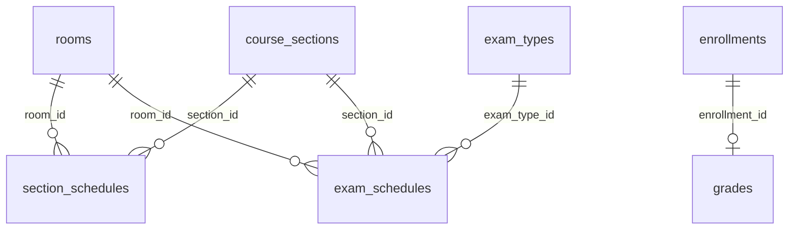

# Chuẩn hóa và bổ sung SQL — 12/11/2026

## Cấu trúc và dữ liệu

Schema ứng dụng có **53 bảng**: 47 bảng gốc; ảnh hồ sơ, token khôi phục, lịch thi, danh mục phòng, danh mục loại thi và sổ migration. Các khóa chính và ID dữ liệu cũ được giữ nguyên. Ba file SQL gốc không bị sửa.

| Phần | Chuẩn hóa/bổ sung |
|---|---|
| Phòng học/phòng thi | `rooms`: mã duy nhất, tên, sức chứa tùy chọn, trạng thái sử dụng |
| Loại kỳ thi | `exam_types`: mã/tên duy nhất, trạng thái sử dụng |
| Buổi học | `section_schedules.room_id` liên kết danh mục bằng FK |
| Lịch thi | `room_id`, `exam_type_id`, nguồn SCHOOL/DEMO, ngày tạo/cập nhật, CHECK thời gian/trạng thái |
| Khôi phục/ảnh | CHECK kiểu ảnh, trạng thái gửi token, thời điểm hết hạn |
| Phiên bản SQL | `schema_migrations`: tên migration, SHA-256, thời điểm áp dụng |
| Hồ sơ demo | Chỉ điền ô còn trống của tài khoản `student_demo_*` có MSSV `DEMO*`; không ghi đè giá trị có sẵn |
| Điểm demo | Bổ sung bản ghi còn thiếu theo `enrollment_id`; không thay điểm cũ hoặc tự công bố bảng điểm |
| Lịch thi demo | 5 lịch minh họa cho lớp chỉ có sinh viên demo; không thay lịch của nhà trường |

Các cột chữ `room`, `exam_type` được giữ để tương thích các view và client cũ. ID danh mục là liên kết gốc; trigger MySQL đồng bộ các cột chữ khi ghi. Backend cũng ghi đồng thời ID và giá trị hiển thị; đổi mã phòng/tên loại thi qua API sẽ cập nhật các giá trị tương thích trong transaction. Đây là lớp chuyển tiếp có chủ đích, không phải hai danh mục độc lập. Không xóa cột mà view hoặc frontend cũ còn sử dụng.

Các giá trị snapshot hóa đơn (`credits_at_issue`, `unit_price_at_issue`) được giữ nguyên vì phục vụ lịch sử đối soát. Thông tin hồ sơ nhập học và sinh viên vẫn có vai trò nghiệp vụ riêng; không gộp/xóa các bảng này để tránh mất lịch sử.

## Điều chỉnh backend/frontend

- PĐT quản lý danh mục phòng và loại kỳ thi. Form lịch học/lịch thi chọn ID từ danh mục, thay cho nhập chuỗi tùy ý.
- API vẫn nhận tên phòng/loại thi từ client cũ nếu tồn tại trong danh mục. Mã không tồn tại hoặc danh mục ngừng hoạt động bị từ chối bằng lỗi nghiệp vụ rõ ràng.
- Không xếp lớp vào phòng có sức chứa nhỏ hơn sĩ số tối đa; không cho tăng sĩ số lớp vượt phòng đã xếp hoặc giảm sức chứa phòng xuống dưới lớp hiện dùng. Phòng ngừng hoạt động không nhận đăng ký mới.
- Lịch thi kiểm tra sức chứa, trùng phòng/giảng viên/sinh viên; khóa các bản ghi liên quan khi ghi. Vẫn có thể hủy lịch cũ nếu danh mục phòng/loại thi đã bị ngừng sử dụng.
- Hồ sơ demo và lịch thi demo có nhãn/cảnh báo. Dữ liệu điền thêm là dữ liệu thử, không xác nhận danh tính thật. Giới tính chưa cung cấp dùng `UNDISCLOSED`, không tự suy đoán giới tính.
- Token, mật khẩu, JWT và cấu hình SMTP không được bổ sung vào seed. Không bật các tài khoản seed, hộp thư hay worker gửi email trong migration.

## Quy trình an toàn

1. Sao lưu database hiện tại bằng `mysqldump --single-transaction`, gồm view/trigger/routine. Backup nằm trong `backend/.local/backups/`, được Git bỏ qua.
2. Khôi phục vào database kiểm thử mới, kiểm tra checksum dữ liệu trước khi chạy migration.
3. Áp dụng 05–10 vào bản sao, ghi phiên bản/checksum, chạy `v_normalization_checks`.
4. Chạy backend/frontend trên bản sao để thử các API và màn hình. Các thao tác ghi thử không thực hiện trên database đang dùng.
5. Kiểm tra lại dữ liệu nguồn không đổi, dừng backend cũ, áp dụng đúng migration đã thử vào database chính, khởi động lại backend và kiểm tra giao diện.

Lệnh và thứ tự cài mới/nâng cấp tại [data/v6/README.md](../data/v6/README.md). Database kiểm thử và backup được giữ lại. Nếu nâng cấp lỗi giữa các lệnh DDL, giữ database để kiểm tra; không chạy lại SQL gốc hoặc giả định rollback DDL. Phục hồi có kiểm soát từ backup vào database mới rồi kiểm tra trước khi chuyển cấu hình kết nối.

## Kiểm tra đã thực hiện

- Nâng cấp từ bản sao MySQL hiện có và cài mới từ 01–03 + 05–10 đều thành công.
- Chạy lại 08–10 trên bản sao không nhân đôi sinh viên, điểm hoặc lịch thi.
- 10 truy vấn toàn vẹn đều trả `violation_count=0`: FK/danh mục, thời gian/trạng thái thi, hồ sơ demo, bảng điểm còn thiếu, trùng học phần, trùng lịch thi, thu vượt hóa đơn, bàn giao và trạng thái email.
- Bộ kiểm thử backend bao gồm các luồng đăng ký, điểm, quyền, chuẩn hóa phòng/loại thi, mã không tồn tại, đổi mã phòng và hủy lịch khi danh mục ngừng sử dụng.
- MySQL bản sao đã thử tạo/hủy lịch bằng ID, từ chối lịch trùng, đổi mã phòng và kiểm tra các bản ghi lịch vẫn đồng bộ.
- Trình duyệt kiểm tra sinh viên và PĐT trên MySQL bản sao; sáu vai trò trên H2 độc lập. Các kết quả cuối được ghi ở phần nghiệm thu bên dưới.

Các kiểm tra bao phủ những tình huống nêu trên; không phải cam kết mọi tổ hợp dữ liệu tương lai sẽ không có lỗi. Các thay đổi sau này tiếp tục cần migration và kiểm thử trước triển khai.

## Nghiệm thu sau khi áp dụng

- Đã áp dụng 05–10 vào `sms_v6_original`, ghi đủ 6 phiên bản trong `schema_migrations`.
- Database chính: 53 bảng, 6 sinh viên, 13 bản ghi điểm, 5 phòng, 2 loại thi, 5 lịch thi mẫu; tổng vi phạm toàn vẹn bằng 0.
- 26 kiểm thử backend nghiệp vụ đạt; bài kiểm thử trình duyệt sáu vai trò chạy riêng đạt. FE build và 4 kiểm thử API đạt.
- Sáu vai trò/H2: 417 lượt kiểm tra, 123 hộp chi tiết, không phát hiện lỗi JS/API/bố cục.
- PĐT/MySQL bản sao: 165 lượt kiểm tra, 56 hộp chi tiết. Sinh viên/MySQL chính: 61 lượt kiểm tra, 13 hộp chi tiết; đều không phát hiện lỗi JS/API/bố cục.
- Trước đó hai lượt kiểm tra trình duyệt bị dùng chung cổng Chrome. Công cụ đã được sửa để nhận cổng riêng qua `SMS_UI_DEBUG_PORT`, sau đó cả hai bộ được chạy lại và đạt. Đây là lỗi công cụ kiểm thử, không phải lỗi dữ liệu đã bỏ qua.
- Kiểm tra checksum migration và toàn vẹn sau triển khai: `python backend/scripts/Migrate-Database.py --check` trả `READ_ONLY_CHECK_OK`.
- Backend chính chạy cổng 8081; giao diện chạy tại `http://127.0.0.1:5173/`.

Xem [danh mục cột và khóa của toàn bộ 53 bảng](SQL_DANH_MUC_CHUAN_HOA.md). Backup trước nâng cấp và các database thử nghiệm được giữ riêng; không đưa vào Git.
