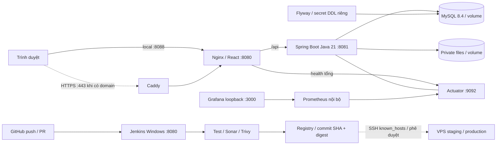
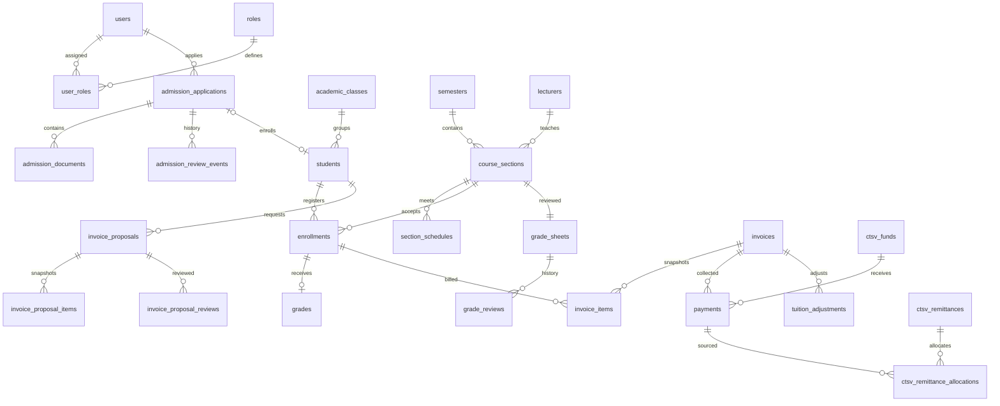

# Kiến trúc vận hành

## Phân tách quyền

Runtime `sms_app` chỉ SELECT/INSERT/UPDATE/DELETE trong database ứng dụng; không CREATE/DROP/GRANT. `sms_migrator` được DDL trong đúng database, không là root. Root chỉ phục vụ khởi tạo/backup và không đưa cho backend. Bật trust-function-creators để migration user tạo trigger khi binary log bật; runtime vẫn không có quyền tạo trigger.

Backend/frontend chạy non-root, filesystem read-only, bỏ Linux capabilities; chỉ thư mục private-files và tmp được ghi. Dữ liệu MySQL và tệp private dùng named volumes. Không dùng IIS. Không tạo actor Admin thứ bảy.

## Version dữ liệu

`db/migration/core/V1__v6_normalized_schema.sql` là schema nền đóng băng từ bản cài trắng đã kiểm tra (V6 + 05–14), có danh mục 6 quyền/loại thi và checksum nguồn. Không có hồ sơ, điểm, hóa đơn hoặc khoản thu cá nhân. Flyway bổ sung bảng lịch sử, nên container có 57 bảng thay vì 56 bảng của bản chạy trực tiếp trên máy.

`db/migration/demo/V2__fictional_demo_only.sql` chỉ dùng local/test; bao gồm các dữ liệu thực hành được yêu cầu. Nạp danh mục phòng trước seed vì trigger đã được tạo từ baseline; tương thích mã SV mới khi bổ sung điểm demo. Không sửa lại các migration 05–14 đã áp dụng ở database cũ. Production chỉ cấu hình location `core`; không tự baseline schema có sẵn và không bật baseline-on-migrate. Database cũ phải backup/restore rehearsal và lập kế hoạch chuyển lịch sử riêng.

Thay đổi tương lai thêm V3, V4... vào core; không sửa V1/V2 đã triển khai. Nếu CI từng chạy demo V2, production core V3 vẫn hợp lệ do V2 là migration riêng của môi trường demo. Không dùng `repair` để bỏ qua checksum lỗi mà chưa điều tra.

## ERD nghiệp vụ trọng yếu

Danh sách đầy đủ cột/FK: [SQL catalog](../SQL_DANH_MUC_CHUAN_HOA.md), [DDL versioned](../../db/migration/core/V1__v6_normalized_schema.sql). Luồng học phí bổ sung yêu cầu BGH duyệt đề nghị trước khi CTSV phát hành, theo yêu cầu gần nhất của chủ dự án.
